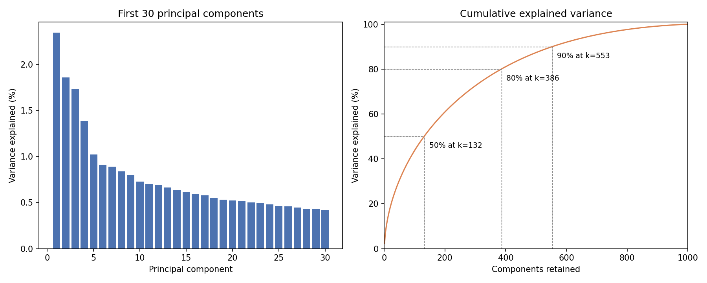

# Project 3: Word Embeddings

**Albert Kabore**

PhD student in AI

## 1. Introduction

This project represents BBC news articles with term frequency–inverse document frequency (TF-IDF) and reduces their dimensionality using Principal Component Analysis (PCA). TF-IDF assigns weights to terms within each document. PCA combines these features into new coordinates ordered by the variance they retain.

The objective is to reduce the number of coordinates per document while preserving at least 90% of sample variance. The 90% threshold is a choice for this analysis; the assignment does not prescribe a numerical threshold. The analysis explicitly calculates feature means, centered data, sample covariance, and sorted eigenvalues and eigenvectors. PCA maximizes retained variance for a fixed number of orthonormal projection directions (Jolliffe & Cadima, 2016). Here, information retention refers to variation in TF-IDF weights. Because the observations are articles, the resulting embeddings represent documents.

## 2. Dataset

The [BBC News Archive](https://www.kaggle.com/datasets/hgultekin/bbcnewsarchive), distributed on Kaggle by `hgultekin`, contains 2,225 articles across five categories: business, entertainment, politics, sport, and tech. Each document combines an article's title and body. The category labels are not used to calculate TF-IDF weights or PCA directions.

## 3. Data Cleaning

The cleaning procedure checks the required columns, missing entries, and category labels before modifying the article text. The results recorded in `data/cleaning_report.json` are:

| Step | Operation | Result |
|---|---|---|
| Schema and missing entries | Check required columns, missing values, and expected categories | No missing entries or unknown categories |
| Whitespace | Strip ends and collapse repeated whitespace | 2,225 article bodies changed |
| Character repair | Replace one damaged currency character with £ based on context | One article changed |
| Exact duplicates | Keep the first occurrence of each normalized body | 136 copies removed |
| Near-duplicates | Compare bodies with identical headlines using Jaccard word-set similarity of at least 0.8 | 23 articles removed |
| Length | Remove bodies with fewer than 50 whitespace-separated words | None removed; shortest retained body has 84 words |

Jaccard similarity is the number of distinct words shared by two articles divided by the number in their union. The similarity and length thresholds are preprocessing choices. The same-headline rule can leave related stories with different titles. After cleaning, **2,066 articles** remain for TF-IDF and PCA.

## 4. TF-IDF Representation

For term t and document d, term frequency `tf(t,d)` is the raw count, and document frequency `df(t)` counts documents containing t. The smoothed inverse document frequency is:

`idf(t) = ln((1 + n) / (1 + df(t))) + 1`

The unnormalized weight is `tf(t,d) × idf(t)`. Each nonzero document vector is then divided by its Euclidean length (scikit-learn developers, *Feature extraction*).

The implementation lowercases text, keeps tokens of at least two word characters, and removes English stop words. Tokens can include letters, digits, and underscores. The vocabulary contains the 1,000 most frequent terms among those appearing in at least two documents.

The resulting matrix X has **2,066 rows and 1,000 columns**, with **93.28% zero entries**. Rows represent documents and columns represent terms. The matrix is sparse in its values but is stored as a dense NumPy array for this explicit covariance calculation. PCA produces dense document vectors with fewer coordinates.

## 5. PCA Calculations

### 5.1 Mean and centering

For n documents and feature j, calculate the column mean:

`μ_j = (1/n) Σ_i X_ij`

Subtract it from each value in that column:

`X_c = X − μ`

Centering makes each feature's mean zero, within numerical precision. PCA then describes variation around the mean. Feature columns are not scaled to unit variance in this analysis.

### 5.2 Covariance matrix

Calculate the sample covariance matrix:

`C = X_cᵀ X_c / (n − 1)`

C is a 1,000 × 1,000 matrix. Diagonal entries are feature variances. An off-diagonal entry measures how two feature weights vary together around their means. The denominator n − 1 accounts for estimating the mean from the same observations.

C is symmetric and positive semidefinite. Its eigenvalues are therefore real and nonnegative in exact arithmetic.

### 5.3 Sorted eigenvalues and eigenvectors

Solve `C v_i = λ_i v_i`. The eigenvector v_i defines a unit-length direction, and λ_i is the variance along that direction.

NumPy's `eigh` returns eigenvalues in ascending order and corresponding eigenvectors in columns. Both arrays must be reordered with the same sorting indices to place the largest eigenvalues first (NumPy Developers, *numpy.linalg.eigh*).

### 5.4 Projection and retained variance

Let W contain the first k eigenvectors as columns. The reduced document matrix is:

`Z = X_c W`

For a unit-length direction v, projected variance is `vᵀ C v`. The leading eigenvector maximizes this quantity. Subsequent eigenvectors maximize the remaining variance subject to orthogonality. Keeping the first k therefore retains `Σ_{i=1}^k λ_i`, the largest total variance available from k orthonormal directions (Jolliffe & Cadima, 2016).

The fraction retained by component i is `λ_i / Σ_j λ_j`. Choose the smallest k whose cumulative fraction reaches the desired threshold. This project uses **90%**.

Reconstruction connects retained variance to information loss. With `X_hat = Z Wᵀ + μ`, the mean squared error per original matrix entry is:

`MSE_k = ||X − X_hat||_F² / (n p) = ((n − 1) / (n p)) Σ_{i>k} λ_i`

Here, `||A||_F²` is the sum of squared entries of A. Relative squared reconstruction error divides this residual by `||X − μ||_F²`, the error from reconstructing every article as the mean document. It equals one minus the retained variance fraction. Selecting the largest eigenvalues therefore also minimizes reconstruction error among projections with k orthonormal directions.

## 6. Python Code

The function below performs each required calculation and returns the intermediate results. It accepts a finite numeric matrix with at least two observations and positive total variance.

```python
import numpy as np

def pca_reduce(X, variance_target=0.90):
    X = np.asarray(X, dtype=float)
    if X.ndim != 2 or X.shape[0] < 2 or not np.isfinite(X).all():
        raise ValueError("X must be finite, 2-D, with at least two rows")
    if not 0 < variance_target <= 1:
        raise ValueError("variance_target must be in (0, 1]")

    # Feature means, centered data, and sample covariance.
    mean = X.mean(axis=0)
    centered = X - mean
    covariance = centered.T @ centered / (X.shape[0] - 1)

    # Sort eigenvalues and matching eigenvector columns together.
    values, vectors = np.linalg.eigh(covariance)
    order = np.argsort(values)[::-1]
    values = np.maximum(values[order], 0.0)  # remove negative roundoff
    vectors = vectors[:, order]

    # Choose consistent signs for the displayed eigenvectors.
    pivots = np.argmax(np.abs(vectors), axis=0)
    signs = np.sign(vectors[pivots, np.arange(X.shape[1])])
    vectors *= np.where(signs == 0, 1, signs)

    total = values.sum()
    if total == 0:
        raise ValueError("Explained variance requires positive variance")
    ratios = values / total
    cumulative = np.cumsum(ratios)
    cumulative[-1] = 1.0  # avoid a rounding error at a 100% target
    k = int(np.searchsorted(cumulative, variance_target) + 1)

    W = vectors[:, :k]
    reduced = centered @ W
    reconstructed = reduced @ W.T + mean
    squared_error = np.sum((X - reconstructed) ** 2)
    return {
        "mean": mean, "centered": centered, "covariance": covariance,
        "eigenvalues": values, "eigenvectors": vectors,
        "explained_variance_ratio": ratios,
        "n_components": k, "reduced": reduced,
        "reconstruction_mse": squared_error / X.size,
        "relative_squared_error": squared_error / np.sum(centered ** 2),
    }
```

Apply the function to the project's TF-IDF matrix:

```python
from word_embeddings.cleaning import clean_dataset
from word_embeddings.data import load_raw
from word_embeddings.tfidf import TfidfVectorizer

articles, _ = clean_dataset(load_raw())
vectorizer = TfidfVectorizer(max_features=1000, min_df=2)
X = vectorizer.fit_transform(articles["text"].tolist())
result = pca_reduce(X, variance_target=0.90)
print(result["reduced"].shape)  # (2066, 553)
print(result["reconstruction_mse"])     # approximately 0.0000940871
print(result["relative_squared_error"])  # approximately 0.0998391
```

## 7. Plain-English Explanation

The code first calculates each term's average TF-IDF weight and subtracts it from every document. It then calculates covariance to measure how term weights vary together.

The eigensolver finds perpendicular directions through the centered data. Each eigenvalue gives the variance along its corresponding direction. Sorting both arrays together ranks these directions without separating an eigenvalue from its eigenvector.

Dividing the eigenvalues by their sum gives their shares of total variance. The code adds these shares until they reach 90%, then projects the centered documents onto the selected directions. Every article receives one coordinate per retained component.

The code also reconstructs the original term weights from those coordinates. Squared differences measure the variation lost. Comparing this error with the error of using the mean document for every article makes the loss interpretable despite the small scale of individual TF-IDF weights.

An eigenvector and its negative describe the same direction. The sign convention makes the displayed coefficients consistent without changing retained variance. Repeated eigenvalues can allow different orthonormal bases for the same subspace.

## 8. Results

### 8.1 Means and covariances

The following feature means and diagonal covariance entries are calculated from the cleaned corpus:

| Term | Mean TF-IDF weight | Sample variance |
|---|---|---|
| said | 0.069890 | 0.002981 |
| mr | 0.043615 | 0.006949 |
| labour | 0.017413 | 0.004176 |
| blair | 0.014131 | 0.003604 |
| film | 0.025191 | 0.008568 |
| game | 0.021221 | 0.004264 |

A high mean does not imply high variance. For example, said has the largest mean among these terms, but film varies more across documents. PCA uses centered variation and covariance, so average weight alone cannot determine a term's influence on a component. After centering, the largest absolute column mean is 3.81 × 10⁻¹⁶.

An excerpt of the sample covariance matrix shows the relationships between selected terms:

| Term | labour | blair | film | game |
|---|---|---|---|---|
| labour | 0.004176 | 0.001595 | -0.000402 | -0.000352 |
| blair | 0.001595 | 0.003604 | -0.000309 | -0.000276 |
| film | -0.000402 | -0.000309 | 0.008568 | -0.000329 |
| game | -0.000352 | -0.000276 | -0.000329 | 0.004264 |

Labour and blair rise together relative to their means, whereas labour and film tend to deviate in opposite directions. These are relationships between normalized term weights across articles, not evidence of causation or mutually exclusive word use.

### 8.2 Eigenvalues and eigenvectors

The total sample variance is **0.942844**. The first five sorted eigenvalues are:

| Component | Eigenvalue | Percentage of total variance |
|---|---|---|
| PC1 | 0.022090 | 2.34% |
| PC2 | 0.017540 | 1.86% |
| PC3 | 0.016323 | 1.73% |
| PC4 | 0.013055 | 1.38% |
| PC5 | 0.009655 | 1.02% |

Each eigenvector contains 1,000 coefficients. Selected entries from the first three eigenvectors are:

| Term | PC1 coefficient | PC2 coefficient | PC3 coefficient |
|---|---|---|---|
| said | 0.121288 | 0.002514 | -0.029479 |
| mr | 0.357007 | 0.167236 | 0.085800 |
| labour | 0.240837 | 0.202448 | 0.084445 |
| blair | 0.193686 | 0.169348 | 0.072873 |
| film | -0.142227 | -0.124481 | 0.541733 |
| game | -0.155861 | 0.137226 | -0.088092 |

Under the displayed sign convention, PC1 contrasts positive political terms with negative film and game weights. PC2 places game and labour on the same side, while film remains opposite them. Film has a substantially larger coefficient on PC3. The components therefore mix vocabulary contrasts instead of mapping directly to individual categories. Relative signs within a component matter; reversing an entire eigenvector leaves its variance unchanged.

The smallest eigenvalue is approximately 9.6433 × 10⁻⁶. Thus, the discarded directions have nonzero observed variance; discarding them is a loss accepted under the chosen threshold. The notebook computes the full eigenvalue and eigenvector arrays.

### 8.3 Variance retention and reconstruction

Reconstruction uses the retained coordinates to estimate the original TF-IDF weights. The mean-only baseline has MSE **0.0009423876**. Relative squared error divides each reconstruction MSE by that baseline:

| Components | Variance retained | MSE per entry | Relative squared error |
|---|---|---|---|
| 2 | 4.2032% | 0.00090278 | 95.7968% |
| 50 | 30.5482% | 0.00065450 | 69.4518% |
| 132 | 50.1415% | 0.00046986 | 49.8585% |
| 386 | 80.0519% | 0.00018799 | 19.9481% |
| 552 | 89.9704% | 0.00009452 | 10.0296% |
| 553 | 90.0161% | 0.00009409 | 9.9839% |
| 1,000 | 100.0000% | 5.22e-33 | 0.0000% |

The smallest dimension meeting 90% is **553**: 552 components retain **89.9704%**, while 553 retain **90.0161%**. The 2,066 × 553 matrix removes 44.7% of the dense coordinates per document. Increasing from 386 to 553 components adds 167 coordinates to recover approximately ten percentage points of variance and reduce relative error from 19.95% to 9.98%.

The MSE at 553 components is **0.0000940871**, compared with **0.0009027771** at two components. Small absolute values partly reflect the scale and sparsity of TF-IDF weights; the relative errors make the losses comparable. Full-component reconstruction has an error of about 5.22 × 10⁻³³, consistent with numerical rounding.

For a control comparison, an orthonormal basis obtained by QR factorization of a Gaussian random matrix (`default_rng(42)`) retains **55.3384%** at the same 553 dimensions, compared with PCA's **90.0161%**. This is one reproducible comparison, not an estimate over repeated random projections. It illustrates the benefit of selecting directions from the covariance; the mathematical variance-maximization argument establishes optimality.



### 8.4 Numerical verification

The notebook checks zero centered means, covariance agreement with `numpy.cov`, descending eigenvalue order, orthonormal eigenvectors, the eigenpair equation, and equality between projected variances and retained eigenvalues. It also verifies that residual squared error equals the sum of discarded eigenvalues after accounting for the sample-covariance denominator.

The maximum covariance difference is approximately **4.34 × 10⁻¹⁹**; the maximum difference between the first ten eigenvalues and scikit-learn PCA is approximately **1.39 × 10⁻¹⁷**. The maximum eigenpair residual is **1.06 × 10⁻¹⁷**, and the maximum orthogonality error is **2.99 × 10⁻¹⁵**. These results support numerical correctness; they do not establish semantic or predictive performance.

The notebook writes the means, covariance excerpt, loadings, reconstruction results, and random-basis comparison to `results/output_analysis.json`.

## 9. Observations

- Mean weights differed: said averaged 0.069890 and mr 0.043615; centering reduced every feature mean to numerical zero within rounding precision.

- Labour and blair had positive covariance, 0.001595, while labour and film had negative covariance, -0.000402, revealing contrasting document weight patterns.

- PC1 combined positive political vocabulary with negative film and game coefficients; PC3 gave film a much stronger positive coefficient, 0.541733.

- The first four components retained only 7.32% of variance; reaching 80% required 386 dimensions, and reaching 90% required 553 dimensions.

- Reconstruction error at 553 components was 0.000094087 per entry, equivalent to 9.98% of the mean-only reconstruction error across all documents.

## 10. Final Insights

- The measured spectrum supports moderate compression at the selected threshold: 553 components retain 90.02%, whereas 386 retain 80.05%. Recovering approximately ten additional percentage points therefore costs 167 coordinates. Since the first four components retain only 7.32%, interpretable leading directions account for a small share of the full representation's measured variation.

- Positive labour-blair covariance and negative labour-film covariance agree with PC1's opposing political and entertainment coefficients. Film dominates PC3; game opposes labour in PC1 but aligns with it in PC2. These relative patterns show several overlapping vocabulary contrasts, so assigning each principal component a distinct topic would misrepresent the calculated structure.

- At 553 dimensions, reconstruction leaves 9.98% of centered squared variation, compared with 95.80% at two dimensions. One fixed-seed orthogonal projection retains only 55.34% at 553 dimensions, supporting the value of selecting eigenvectors. This comparison illustrates PCA's advantage; the variance-maximization argument establishes optimality, while neither result establishes preservation of semantic meaning.

## 11. Recommendations

- Use 553 components for the chosen 90% target: 552 retain only 89.97%, so rounding the cumulative percentages could select an insufficient dimension. Consider 386 components only when accepting approximately 20% reconstruction loss is appropriate. Report the threshold, dimension, retained fraction, and relative reconstruction error together to make the compromise explicit.

- Investigate preprocessing through controlled comparisons focused on the observed loadings. Removing mr merely because it resembles a style term could remove political distinctions represented by PC1. Compare versions with and without selected terms, refitting TF-IDF and PCA each time, and examine changes in loadings, covariance, and reconstruction at matched dimensions.

- Evaluate reconstruction relative to the mean-only baseline, since the small absolute error partly reflects normalized, mostly zero TF-IDF weights. Distinguish coordinate reduction from storage savings: original documents average about 67 nonzero weights, whereas the reduced vectors contain 553 dense coordinates. Measure sparse and dense storage before making any efficiency claim.

## 12. Conclusion

PCA reduces the 1,000-feature representation of 2,066 cleaned articles to 553 coordinates, retaining 90.0161% of sample variance. This is the smallest dimension meeting the selected 90% target. Reconstruction leaves 9.9839% of the centered squared variation, so the reduction has a measurable cost even though its absolute MSE is small.

The covariance and loadings identify overlapping lexical contrasts: political terms covary positively and oppose film weights on PC1, while film has its largest displayed coefficient on PC3. These interpretable directions retain only part of the corpus's variation. The explicit mean, centering, covariance, sorted eigenpairs, and reconstruction checks establish the required computations and clarify their limits: retained variance measures variation in TF-IDF weights, not preserved meaning or task accuracy.

## 13. References

hgultekin. (n.d.). *BBC News Archive* [Data set]. Kaggle. https://www.kaggle.com/datasets/hgultekin/bbcnewsarchive

Jolliffe, I. T., & Cadima, J. (2016). Principal component analysis: A review and recent developments. *Philosophical Transactions of the Royal Society A, 374*(2065), 20150202. https://doi.org/10.1098/rsta.2015.0202

NumPy Developers. (n.d.). *numpy.linalg.eigh*. https://numpy.org/doc/stable/reference/generated/numpy.linalg.eigh.html

scikit-learn developers. (n.d.). *Feature extraction: TF-IDF term weighting*. https://scikit-learn.org/stable/modules/feature_extraction.html#tfidf-term-weighting

scikit-learn developers. (n.d.). *PCA*. https://scikit-learn.org/stable/modules/generated/sklearn.decomposition.PCA.html

## 14. AI Use and Disclosure

I used OpenAI Codex to assist with code development, interpretation of results, and drafting and revising the notebook and report. The work was verified by executing the notebook, running automated tests, comparing numerical results with NumPy and scikit-learn, and checking cited sources; I remain responsible for the accuracy, originality, and integrity of this submission.
